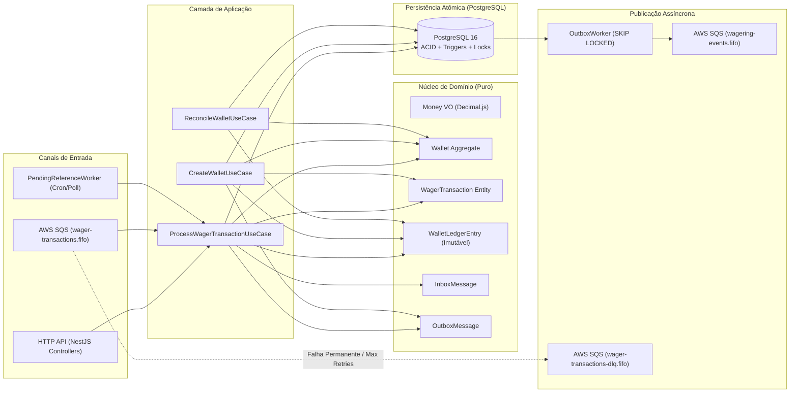
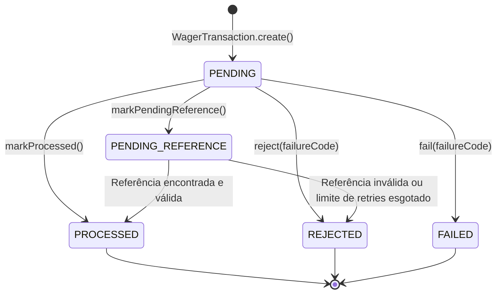

# Architecture & Technical Decisions — Distributed Wagering Processor

## 1. Visão Geral da Arquitetura

O **Distributed Wagering Processor** foi projetado seguindo **Domain-Driven Design (DDD)** tático e **Clean / Hexagonal Architecture**, separando rigorosamente as invariantes financeiras de domínio dos detalhes de transporte (HTTP REST e AWS SQS) e persistência (PostgreSQL via MikroORM).



---

## 2. Autenticação e Identidade de Provedores (Seção 2)

Conforme permitido pela Seção 2 do desafio, optamos por **não subir um container de Identity Provider externo** para concentrar o orçamento de engenharia nos critérios avaliados (correção financeira, concorrência multi-instância, idempotência persistente, Transactional Outbox e testes reais).

### Ponto de Extensão Explícito no Código
Deixamos o contrato e o guard prontos em `src/presentation/http/guards/auth.guard.ts`:
- **`ProviderIdentityPort`**: porta de domínio/aplicação para validação de tokens OIDC (`verifyToken(bearerToken: string): Promise<AuthenticatedPrincipal | null>`).
- **`ExternalIdpAuthGuard`**: registrado globalmente via `APP_GUARD`, respeitando o decorator `@Public()` nos endpoints abertos (`/health/live`, `/health/ready` e `/metrics`).

### Desenho para Produção (Keycloak / Zitadel)
Em produção, a integração segue o fluxo **OAuth 2.0 Client Credentials (RFC 6749)** combinado com **mTLS** no API Gateway:
1. Cada provedor de jogos recebe um `client_id` / `client_secret` (ou certificado cliente X.509) em um realm dedicado no **Keycloak** ou **Zitadel**.
2. O token JWT emitido contém a claim customizada `provider_id` e escopos (`wagering:write`, `wagering:read`).
3. O `ExternalIdpAuthGuard` valida a assinatura criptográfica (`RS256`/`ES256`) localmente via **JWKS com cache em memória e rotação automática de `kid`**, sem chamadas síncronas ao IdP por requisição.
4. O guard garante que `principal.providerId === body.providerId`, impedindo *spoofing* de identidade entre provedores.

---

## 3. Escolha do ORM, Mapeamento de `Money` e Estratégia Transacional

### 3.1 Por que MikroORM (`@mikro-orm/postgresql`)?
Escolhemos o **MikroORM 6** (opção preferencial do desafio) pelos seguintes motivos:
- **Unit of Work e Identity Map explícitos por contexto transacional**: cada chamada a `em.transactional(async (txEm) => ...)` cria um `EntityManager` isolado (`txEm`), garantindo que todas as mutações em `Wallet`, `WagerTransaction`, `WalletLedgerEntry`, `InboxMessage` e `OutboxMessage` façam `COMMIT` ou `ROLLBACK` em uma única transação SQL atômica.
- **Suporte nativo a `LockMode.PESSIMISTIC_WRITE`**: permite emitir `SELECT ... FOR UPDATE` diretamente na leitura do agregado `Wallet`.
- **Migrations versionadas e reversíveis**: controle total sobre DDL, `CHECK` constraints, índices parciais e *triggers* PL/pgSQL.

### 3.2 Precisão Monetária (`Money` Value Object)
- Nenhum valor financeiro utiliza `number`, `float` ou `double` em nenhuma camada do sistema.
- O Value Object `Money` (`src/domain/models/money.vo.ts`) encapsula uma instância imutável de `Decimal` (`decimal.js`) e valida entradas via expressão regular estrita `/^\d+\.\d{2}$/`, rejeitando `NaN`, `Infinity`, notação científica, strings vazias, mais ou menos de 2 casas decimais e valores negativos em contratos de entrada.
- No PostgreSQL, todos os valores monetários são armazenados como `NUMERIC(18, 2)` com coluna `currency VARCHAR(3)` explícita e reidratados como `Money`.

---

## 4. Concorrência e Ordenação por `walletId` (Seção 8)

### 4.1 Estratégia Adotada: Pessimistic Write Locking por `walletId`
A unidade de concorrência do sistema é a `walletId`. Toda operação financeira que afeta ou consulta uma carteira adquire um lock exclusivo de linha no PostgreSQL:

```sql
SELECT * FROM wallets WHERE id = $1 FOR UPDATE;
```

### 4.2 Justificativa e Trade-offs (Pessimistic vs. Optimistic Locking)
- **Por que Pessimistic Locking (`SELECT ... FOR UPDATE`)?**
  Em plataformas de iGaming, dois cenários são frequentes na mesma carteira (*hot wallet*):
  1. Apostas rápidas simultâneas disputando o mesmo saldo (ex.: saldo de `100.00 BRL` com duas apostas simultâneas de `80.00 BRL`);
  2. Tempestades de *retries* idempotentes (ex.: 50 requisições simultâneas para a mesma aposta quando há instabilidade de rede no provedor).
  Com *Optimistic Locking* puro, 49 das 50 requisições sofreriam `OptimisticLockError`, exigindo *retries* em loop na aplicação e gerando *rollbacks* caros no banco. Com `SELECT ... FOR UPDATE` na linha da `wallet`:
  - Operações na **mesma carteira** são enfileiradas de forma determinística pelo motor de locks do PostgreSQL em frações de milissegundo;
  - Operações em **carteiras distintas** rodam 100% em paralelo sem qualquer contenção global;
  - Funciona de forma idêntica com **1, 3 ou N instâncias** da aplicação.
- **Papel da coluna `version` na `Wallet`:**
  Mantemos o campo `version` iniciando em `1` e incrementando **somente quando o saldo muda** (operações `LOSS` e `REJECTED` não incrementam `version`). Essa versão é propagada no evento `WalletBalanceChanged` (`walletVersion`), permitindo que consumidores *downstream* detectem ordenação de eventos da carteira sem depender de relógio físico.

---

## 5. Idempotência Persistente e Hash Canônico (Seção 9)

### 5.1 Algoritmo de JSON Canônico (`CanonicalJsonService`)
Para evitar falsos conflitos causados pela ordem das chaves JSON em diferentes serializadores HTTP/SQS:
1. Extraímos exclusivamente o subconjunto de campos de negócio da transação (`providerId`, `externalTransactionId`, `playerId`, `walletId`, `roundId`, `gameId`, `kind`, `money: { amount, currency }`, `referenceExternalTransactionId`). Headers HTTP e metadados de transporte (`messageId`, `correlationId`) ficam fora do hash.
2. Ordenamos recursivamente todas as chaves de objetos em ordem lexicográfica (`Object.keys(record).sort()`).
3. Calculamos o digest `SHA-256` hexadecimal (`payloadHash`).

### 5.2 Double-Checked Idempotency & Saldo Observado no Replay
Para garantir que 50 requisições paralelas idênticas resultem em exatamente **um único lançamento** e **49 replays idempotentes**:
1. **Check Pré-Lock**: verifica se a `idempotency_key` já existe antes de bloquear a carteira (captura replays históricos rapidamente e detecta reutilização indevida de chave entre carteiras diferentes).
2. **Lock da Carteira (`SELECT ... FOR UPDATE`)**: serializa chamadas simultâneas da mesma carteira.
3. **Check Pós-Lock (Refresh)**: após adquirir o lock da carteira, consulta novamente `wager_transactions` com `refresh: true`. Se a transação acabou de ser confirmada pela requisição vencedora:
   - Se `payloadHash` for idêntico → retorna a resposta original com `idempotentReplay: true` e o **`observedBalance` gravado no exato momento em que a transação original foi processada** (cumprindo a Regra 7 da Seção 7 mesmo que o saldo da carteira tenha mudado posteriormente!).
   - Se `payloadHash` divergir → lança `IdempotencyConflictError` (`409 Conflict`).
4. **Fallback de Constraint Única (`SQLSTATE 23505`)**: caso duas requisições sem carteira comum disputem a mesma `idempotency_key`, a constraint `uq_wager_tx_idempotency_key` do PostgreSQL bloqueia a duplicata e o handler resolve a corrida consultando o registro vencedor.

---

## 6. Máquina de Estados, Regras de Negócio e Referências Fora de Ordem

### 6.1 Máquina de Estados de `WagerTransaction`



Estados terminais (`PROCESSED`, `REJECTED`, `FAILED`) são imutáveis tanto na classe de domínio (`assertNotTerminal()`) quanto no próprio PostgreSQL (via trigger `trg_prevent_terminal_wager_tx_update`).

### 6.2 Reprocessamento de `PENDING_REFERENCE` (Seção 7.1)
Quando um `REFUND`, `ROLLBACK` ou `WIN` referenciado chega antes da transação original (`referenceExternalTransactionId`):
1. A transação é salva como `PENDING_REFERENCE`, registra o `observedBalance` atual e enfileira o evento `WagerTransactionPendingReference` na Outbox.
2. O `PendingReferenceWorker` busca periodicamente transações vencidas (`status = 'PENDING_REFERENCE' AND next_retry_at <= NOW()`) usando `FOR UPDATE SKIP LOCKED`.
3. Aplica **backoff exponencial** (`base = 500ms * 2^retryAttempts`, teto de `16s`) até o limite de **5 tentativas** (`MAX_REFERENCE_RETRY_ATTEMPTS = 5`).
4. Esgotadas as 5 tentativas sem que a referência apareça, a transação transiciona para `REJECTED` com `failureCode = REFERENCE_NOT_FOUND` e publica `WagerTransactionRejected` na Outbox.

### 6.3 Taxonomia de `FailureCode` e Mapeamento HTTP (Seções 7.2 e 9)

| Situação | `FailureCode` | Status HTTP | Ação Recomendada ao Provedor |
|---|---|---|---|
| Transação aplicada (`PROCESSED`) | — | `200 OK` | Confirmar operação |
| Aceita aguardando referência (`PENDING_REFERENCE`) | — | `202 Accepted` | Aguardar processamento assíncrono |
| Saldo insuficiente em aposta (`BET`) | `INSUFFICIENT_FUNDS` | `422 Unprocessable Entity` | Não reenviar (terminal de negócio) |
| Reversão causaria saldo negativo (`ROLLBACK`) | `REVERSAL_WOULD_CAUSE_NEGATIVE_BALANCE` | `422 Unprocessable Entity` | Não reenviar; auditar conciliação |
| Transação já revertida anteriormente | `ALREADY_REVERSED` | `422 Unprocessable Entity` | Não reenviar |
| Valor de reversão diferente do original | `REVERSAL_AMOUNT_MISMATCH` | `422 Unprocessable Entity` | Corrigir valor se erro de integração |
| Referência inválida (outro player/round/kind) | `INVALID_REFERENCE` | `422 Unprocessable Entity` | Não reenviar |
| Referência nunca encontrada após retries | `REFERENCE_NOT_FOUND` | `422 Unprocessable Entity` | Verificar envio da transação base |
| Moeda da operação difere da carteira | `CURRENCY_MISMATCH` | `422 Unprocessable Entity` | Corrigir moeda |
| Reuso de `Idempotency-Key` com payload diferente | `IDEMPOTENCY_PAYLOAD_MISMATCH` | `409 Conflict` | Gerar nova chave ou corrigir bug |
| Carteira duplicada (`playerId` + `currency`) | `WALLET_ALREADY_EXISTS` | `409 Conflict` | Consultar carteira existente |
| Carteira ou transação não encontrada | `WALLET_NOT_FOUND` / `TRANSACTION_NOT_FOUND` | `404 Not Found` | Verificar identificadores |
| Formato de valor inválido / `OPENING` externo | `INVALID_AMOUNT_FORMAT` / `INVALID_TRANSACTION_KIND` | `400 Bad Request` | Corrigir contrato de entrada |
| Falha transitória de banco/rede | `INTERNAL_ERROR` | `503 Service Unavailable` | Reenviar com a mesma `Idempotency-Key` |

---

## 7. Mensageria SQS, Transactional Inbox e Outbox (Seções 10 e 11)

### 7.1 Atomicidade entre Inbox, Domínio e Outbox
Quando uma mensagem chega pela fila `wager-transactions.fifo`:
1. `SqsWagerConsumerWorker` invoca o mesmo `ProcessWagerTransactionUseCase` usado pela API HTTP, passando `{ inbox: { consumerName: "sqs-wager-consumer", messageId } }`.
2. Dentro da mesma transação SQL (`em.transactional`):
   - Verifica se `(consumer_name, message_id)` já consta em `inbox_messages`. Se já processada, ignora efeitos colaterais.
   - Insere/marca `inbox_messages`, atualiza `wallets`, insere `wager_transactions`, insere `wallet_ledger_entries` e enfileira os eventos em `outbox_messages`.
3. **ACK somente após o Commit**: `DeleteMessageCommand` só é chamado no SQS depois que o PostgreSQL confirma o commit. Se o worker morrer após o commit e antes do ACK, a mensagem reentregue pelo SQS é interceptada pela tabela `inbox_messages` e confirmada sem duplicar débito/crédito.
4. **Classificação de Falhas no Consumidor SQS**:
   - **Negócio (`REJECTED`)**: gravada no banco + Outbox e recebe ACK na fila principal.
   - **Permanente (JSON malformado, contrato inválido, `WalletNotFoundError`)**: encaminhada imediatamente para `wager-transactions-dlq.fifo` e removida da fila principal.
   - **Transitória (banco indisponível, timeout)**: incrementa contador e aplica backoff exponencial via `ChangeMessageVisibilityCommand` até `MAX_RECEIVE_ATTEMPTS = 3`, indo para a DLQ se esgotar.

### 7.2 Concurrent Outbox Publishers (`FOR UPDATE SKIP LOCKED`)
O `OutboxWorker` seleciona lotes de mensagens pendentes usando:

```sql
SELECT id, aggregate_id, event_type, payload, occurred_at, attempts, next_attempt_at, published_at
FROM outbox_messages
WHERE published_at IS NULL
  AND (next_attempt_at IS NULL OR next_attempt_at <= NOW())
ORDER BY occurred_at ASC
LIMIT 25
FOR UPDATE SKIP LOCKED;
```

Isso permite que múltiplas instâncias publiquem eventos em paralelo sem bloqueio mútuo e sem publicar o mesmo lote simultaneamente.

---

## 8. Garantias Aplicadas no Schema do Banco (Seção 5, Regra 9)

Todas as invariantes críticas estão protegidas diretamente no DDL do PostgreSQL (`Migration20261029000001_initial_schema.ts`):
- **`chk_wallets_balance_non_negative`**: `CHECK (balance >= 0)` na tabela `wallets` — torna impossível saldo negativo mesmo em caso de bug na aplicação.
- **`uq_wallets_player_currency`**: `UNIQUE (player_id, currency)` em `wallets`.
- **`uq_ledger_wallet_transaction`**: `UNIQUE (wallet_id, transaction_id)` em `wallet_ledger_entries` — garante no máximo um lançamento de ledger por transação.
- **`chk_ledger_balanced`**: `CHECK ((direction = 'CREDIT' AND balance_after = balance_before + amount) OR (direction = 'DEBIT' AND balance_after = balance_before - amount))` — garante a equação contábil de cada lançamento no próprio motor SQL.
- **`trg_prevent_ledger_update` & `trg_prevent_ledger_delete`**: *triggers* `BEFORE UPDATE` e `BEFORE DELETE` em `wallet_ledger_entries` que bloqueiam qualquer tentativa de mutação ou exclusão no livro-razão (*append-only* estrito).
- **`uq_wager_tx_idempotency_key` & `uq_wager_tx_provider_external`**: unicidade estrita de chaves de idempotência e de identificadores externos por provedor.
- **`uq_wager_tx_single_processed_reversal`**: índice único parcial (`WHERE status = 'PROCESSED' AND kind IN ('REFUND', 'ROLLBACK') AND reference_transaction_id IS NOT NULL`) que impede dupla reversão da mesma transação no nível do banco.
- **`trg_prevent_terminal_wager_tx_update` & `trg_prevent_wager_tx_delete`**: *triggers* que impedem deleção de transações ou saída de estados terminais (`PROCESSED`, `REJECTED`, `FAILED`).

---

## 9. Limitações Conhecidas e Evolução para Alta Escala

1. **Contenção em Carteiras Extremamente Quentes (*Super Hot Wallets*)**:
   - *Limitação*: como `SELECT ... FOR UPDATE` serializa por `walletId`, uma única carteira que receba > 500 apostas/segundo sofrerá enfileiramento de locks no PostgreSQL. (Carteiras de jogadores normais operam a < 5 req/s, portanto não sofrem contenção).
   - *Evolução*: particionamento de sessão por rodada ou *actor model* com *sticky routing* por `walletId` combinado com *batching* transacional.
2. **Polling da Outbox vs. Log-Based CDC**:
   - *Limitação*: o `OutboxWorker` faz polling periódico com `SKIP LOCKED`.
   - *Evolução*: em altíssima vazão (> 10k eventos/s), substituir o polling por **Debezium (PostgreSQL Logical Replication WAL)** lendo a tabela `outbox_messages` com latência sub-10ms e zero carga de `SELECT` no primário.
3. **Crescimento Infinito de `wallet_ledger_entries` e `outbox_messages`**:
   - *Evolução*: particionamento declarativo do PostgreSQL (`PARTITION BY RANGE (created_at)`) mensal para `wallet_ledger_entries`, e expurgo/arquivamento de registros `outbox_messages` já publicados (`published_at IS NOT NULL`) após 7 dias.

---

## 10. Experimento de Teste de Carga (`bun run test:load`) — Seção 14

### 10.1 Ambiente e Metodologia
- **Ambiente**: Windows 11 + WSL 2 (Docker Engine 29.9.2), containers reais `postgres:16-alpine` e `localstack/localstack:3.7`, runtime **Bun 1.4.4**.
- **Metodologia**:
  - Abertura de **20 carteiras distintas** com saldo inicial de `1000.00 BRL` cada;
  - Disparo em rajada simultânea (`Promise.all`) de **400 transações financeiras** (`20` operações concorrentes por carteira, alternando `BET` e `WIN` de `10.00 BRL`), gerando contenção real de lock por carteira e concorrência entre carteiras distintas;
  - Drenagem do Transactional Outbox para o LocalStack SQS e verificação final da invariante `wallet.balance == saldo reconstruído pelo ledger` nas 20 carteiras.

### 10.2 Resultados Obtidos

| Métrica | Valor Observado |
|---|---|
| **Total de Operações Financeiras** | `400` transações (em 20 carteiras simultâneas) |
| **Duração Total da Rajada** | `4648.21 ms` |
| **Throughput Sustentado** | **`86.05 req/s` (RPS)** |
| **Taxa de Erro (5xx / Rollbacks Indevidos)** | **`0` (`0.00%`)** |
| **Latência `p50` (sob rajada de 400 conexões)** | `2140.87 ms` |
| **Latência `p95`** | `2551.73 ms` |
| **Latência `p99`** | `2713.61 ms` |
| **Conflitos de Idempotência / Unique Race (`23505`)** | `0` |
| **Outbox Lag Final após Drenagem** | `0 ms` |
| **Divergências na Reconciliação (`wallet == ledger`)** | **`0` em todas as 20 carteiras** |

### 10.3 Análise Engenharia dos Resultados
- Como todas as `400` requisições são disparadas no mesmo instante (`t = 0`) via `Promise.all`, cada grupo de `20` requisições da mesma carteira aguarda em fila ordenada pelo lock pessimista (`SELECT ... FOR UPDATE`) e pelo pool de conexões do PostgreSQL.
- Isso explica por que a latência individual por operação completa gira em torno de `~11.6 ms` (`4648 ms / 400 ops`), mas o `p50`/`p95` medido desde o disparo da rajada reflete o tempo de espera na fila do pool (`~2.1s` a `~2.7s`), mantendo **zero erros (`0.00%`)** e **100% de precisão contábil**.

